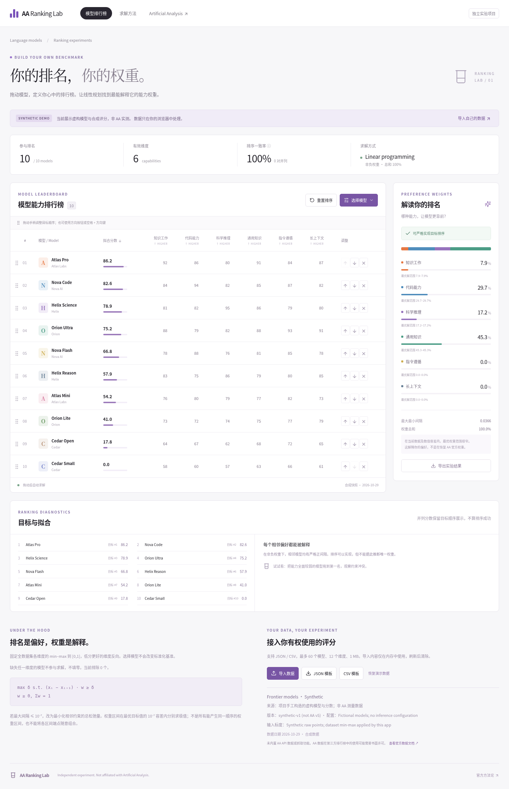

# AA Ranking Lab

**拖动模型，定义你的排行榜；用线性规划解释你的偏好。**

独立、非官方的排行榜实验工具。界面借鉴 Artificial Analysis 的浅色卡片、紧凑表格和紫色强调色，使用自己的名称及图标，与 Artificial Analysis 无隶属关系。



## 运行

Node.js 22+。

```sh
npm ci
npm run dev
```

生产产物：`npm run build` → `dist/`，可部署到任何静态站点服务，包括 GitHub Pages 子路径；Vite 固定使用 `/aa-ranking-lab/` base。没有服务器、账号、分析跟踪或付费服务。已包含 GitHub Pages 自动部署工作流。

```sh
npm run lint
npm test
npm run build           # 含 TypeScript 检查
npx playwright install --with-deps chromium
npm run test:e2e
```

本地如存在 `/usr/bin/chromium` 则使用它，否则使用 Playwright 自带浏览器。CI 自动使用 Playwright Chromium。浏览器测试运行生产构建，需先执行 `npm run build`。

## 功能

- 鼠标、触摸拖动手柄；键盘在手柄上按空格拾取、方向键移动、空格放下，也可使用上下按钮。
- 按名称和提供商筛选选择列表；复选框控制参与模型，筛选不会悄悄移除现有排序约束。
- Web Worker 中运行真正的 LP（`javascript-lp-solver` 1.0.3），不会用普通回归代替。
- 非负且和为 100% 的权重、堆叠图、最优权重区间、拟合排序、相邻冲突和一致率。
- JSON / CSV 本地导入、数据校验、JSON 模板、CSV 模板、实验结果导出、排序重置、演示数据恢复。
- 响应式布局，表格可水平滚动；刷新清空导入数据。没有上传接口或本地持久化。

## 数据真实性与边界

**目前只有合成数据，不包含完整 AA 实测分数，也不自动抓取 AA。** 默认 10 个模型、6 个能力维度均为手工构造：Atlas、Nova、Helix 等是虚构名称。`synthetic=true` 在界面显著标明，快照日期为 2026-10-29。

[官方数据文档](https://artificialanalysis.ai/data-api/docs) 说明免费数据以综合指标为主。API 权限不等于第三方排行产品或公开分发许可。[Data Platform Terms](https://artificialanalysiscdn.com/legal/ProDataPlatformTerms.pdf) 对数据再分发、第三方比较产品等设有限制。因此本仓库没有 AA API 适配器、密钥输入框或采集脚本。请只导入自有或获得相应授权的数据；不要将受限制的原始评分提交到 public repo。代码的 MIT 许可不授予任何第三方数据权利。

本工具的输出是**用户偏好排序的拟合权重**。AA 官方权重是公开的，不需要也不应将该工具称为逆向恢复 AA 秘密算法。当前数据驱动的 min–max 与 AA 官方标度不同，不能直接比较权重大小。见 [官方方法参考](docs/aa-methodology.md)。

## 导入格式

最多 1 MB / 60 模型 / 12 维度；至少 2 模型和 1 维度。数值必须有限且绝对值 ≤ 10⁹。

```json
{
  "name": "My evaluation",
  "source": "Self measured; describe collection method",
  "asOf": "2026-10-29",
  "synthetic": false,
  "version": "eval-v1",
  "configuration": "Same prompt, temperature, reasoning effort and budget",
  "normalization": "Raw points and milliseconds",
  "dimensions": [
    { "id": "reasoning", "label": "Reasoning", "direction": "max" },
    { "id": "latency", "label": "Latency", "direction": "min" }
  ],
  "models": [
    {
      "id": "a",
      "name": "Example A",
      "provider": "Own lab",
      "scores": { "reasoning": 85, "latency": 300 }
    },
    {
      "id": "b",
      "name": "Example B",
      "provider": "Own lab",
      "scores": { "reasoning": 70, "latency": 200 }
    }
  ]
}
```

`name/source/asOf/synthetic` 必填；版本、配置和输入标度建议显式填写，缺省时标记 `unspecified` 或通用原始值说明。它们是来源说明，不改变应用的标准化运算。日期必须是有效 YYYY-MM-DD；来源由用户声明，应用不独立验证。

CSV 必须有 `id,name,provider,source,asOf,synthetic` 六列表头；可附加 `version,configuration,normalization`，其他列都是维度。维度以 `:min` 结尾表示低分更好，以 `:max` 或无后缀表示高分更好。各行来源、日期、synthetic、版本、配置和标度必须一致。空单元格是缺失，不能写 0 代替缺失。参见 [CSV 模板](public/example.csv)。

JSON 可用 `null` 或省略维度值表示缺失。重复 ID、非法数值、错误日期、错误文件格式或过大的文件会被拒绝，并保留原数据。实验导出包含 `dataset` 和求解结果；需要再次导入时取其中的 `dataset` 对象。

## 数学模型

在**完整导入数据集**上计算每个维度的 min/max，变换到 [0,1]；低分更好时用 `1 − normalized`。即使某个不完整模型最终被排除，其已测量维度仍参与确定范围。模型选择不改变基准。任一维度缺失的模型整体排除；常量/全空维度剔除，权重视为 0；不会零填充。若没有有效维度或不足两个完整模型，明确显示无法求解。

给定目标顺序 `x₁ ≻ x₂ ≻ … ≻ xₙ`：

```text
max δ
s.t. (xᵢ − xᵢ₊₁) · w ≥ δ, i=1…n−1
     wⱼ ≥ 0, Σwⱼ = 1
```

实现使用 `t=δ+1`，`0≤t≤2`，因为输入为 [0,1]，所以 `δ∈[-1,1]`。这样可以求出负的最优间隔，也排除了全零权重伪解。仅当最优 `δ>10⁻⁷` 才显示严格可行。相等分数从不当作严格顺序成功。

不能严格实现时，采用预设间隔 `ε=0.01`：

```text
min Σsᵢ
s.t. (xᵢ − xᵢ₊₁) · w + sᵢ ≥ 0.01
     sᵢ ≥ 0, wⱼ ≥ 0, Σwⱼ = 1
```

这是最小**相邻间隔亏损**，不是最少颠倒对数，也不是 Kendall tau 最优化。显示的相邻冲突是间隔 ≤10⁻⁷ 的约束；小正间隔但小于 0.01 也会计入总松弛量。一致率是所有模型对中严格同序的比例，并列不计成功。

对每个权重另做两次 LP，计算在最优目标值 10⁻⁷ 容差内的最小/最大值。它们不是置信区间，不是所有能产生相同顺序的权重范围；各区间端点也不保证能同时取得。多组权重可以解释同一排序。即使最优解范围很窄，也不能证明官方权重唯一。

有限精度、相关维度、标准化基准、选中模型、未测量数据和模型评测配置都会影响结果；拟合分数只是标准化加权和 ×100，不是官方 Intelligence Index。

## 验证与结构

- `src/solver.ts`：LP、严格可行判定、松弛和权重区间。
- `src/data.ts`：合成数据、严格导入校验、标准化及缺失处理。
- `src/App.tsx`：交互排行榜；`solver.worker.ts` 避免求解阻塞主线程。
- 单元测试覆盖正间隔、支配冲突、全相等、循环偏好、内部权重解、多解、随机可行约束、异常导入和标准化。
- Playwright 实际验证桌面拖拽、键盘调整、移动端 touch、不可行排序、重置、搜索、合法/非法导入和最少模型限制。
- CI 执行 lint、单元测试、类型检查、生产构建、浏览器测试，上传截图证据。

[窄屏截图](docs/mobile.png) · [冲突截图](docs/conflict.png)

## GitHub Pages 部署

本地预览地址为 `http://localhost:5173/aa-ranking-lab/`，生产预览地址为 `http://localhost:4173/aa-ranking-lab/`。如果更换仓库名称，需要同步更新 `vite.config.ts` 的 base 和 `playwright.config.ts` 的 baseURL / webServer URL。

`.github/workflows/pages.yml` 在 main 推送或手动触发时执行依赖安装、Lint、单元测试、生产构建、生产浏览器测试，然后上传 `dist` 并部署 GitHub Pages。部署作业仅授予 `pages: write` / `id-token: write`，使用 `github-pages` environment。PR 的 CI 不部署。

仓库存在且有相应权限后，在 **Settings → Pages → Build and deployment → Source** 选择 **GitHub Actions**，然后推送 main 或运行 Deploy Pages。公开网址以部署步骤返回的 `page_url` 为准。预期项目路径为 `/aa-ranking-lab/`；在部署实际成功之前，不应将预期 URL 当作已上线地址。

当前状态：目标仓库查询仍返回 HTTP 404，已有 GitHub integration 不具有创建仓库权限，部署配置仅保存在本地，尚未上传或部署。无需添加任何第三方密钥。
